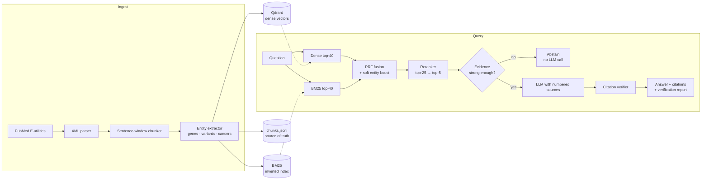

# OncoRAG

[](https://github.com/skazgan/OncoRag/actions/workflows/ci.yml)

**Evidence-grounded retrieval-augmented generation over cancer-genomics literature.**
Ask a question about genes, variants, drugs and resistance; get a short answer where every claim
carries a citation to a PubMed record, is *checked* against its source, and is **refused** when the
literature doesn't support it.

```text
$ oncorag ask "Why do colorectal cancers with KRAS G12C respond poorly to KRAS inhibitors alone?"

Answer
  Colorectal cancer with KRAS G12C responds poorly to single-agent KRAS G12C inhibitors compared
  with lung cancer [1]. Combining a KRAS G12C inhibitor with an anti-EGFR antibody such as
  cetuximab or panitumumab improved response rates in early-phase trials of KRAS G12C-mutant
  colorectal cancer [1]. Sotorasib and adagrasib are covalent inhibitors that lock KRAS G12C in
  its inactive GDP-bound state [2].
Sources
  1  SYN002  Feedback EGFR reactivation limits KRAS G12C inhibitors in colorectal cancer        2023
  2  SYN001  Covalent KRAS G12C inhibitors in previously treated non-small cell lung cancer     2022
Verification: support rate 100%  clean

$ oncorag ask "Which football team won the 2022 World Cup?"
Answer (abstained)
  INSUFFICIENT_EVIDENCE The indexed literature does not appear to address this question ...
```

*(Real output of the offline demo. In this default extractive mode the system returns the most
query-relevant cited sentences; it cannot reason about "why". With `ONCORAG_LLM_BACKEND=anthropic` an LLM
composes the answer from the same numbered sources, under the same verification.)*

> **Research tool, not medical advice.** The bundled demo corpus is **synthetic** (IDs `SYN###`,
> not real publications). Real literature comes from `oncorag ingest`.

## What it demonstrates

| Capability | Where |
|---|---|
| Real data ingestion: PubMed E-utilities client with throttling, batching, retry/backoff, XML parsing | `ingestion/pubmed.py` |
| Domain-aware chunking and entity extraction (genes, variants, cancer types, alias normalisation) | `ingestion/chunking.py`, `entities.py` |
| **Hybrid retrieval**: Qdrant dense + from-scratch BM25, fused with Reciprocal Rank Fusion | `index/`, `retrieval/hybrid.py` |
| Soft entity boosting, metadata filters, reranking, per-article diversification | `retrieval/`, `pipeline.py` |
| **Grounded generation** behind a swappable LLM interface (Anthropic client included), injection-aware prompt | `generation/` |
| **Citation verification**: phantom sources, uncited claims, unsupported numbers | `generation/citations.py` |
| **Abstention** on weak evidence, with a threshold-calibration command | `pipeline.py`, `evaluation/runner.py` |
| **Evaluation harness**: ablation ladder, Recall/MRR/nDCG with bootstrap CIs, answer-level metrics, synthetic question generation | `evaluation/` |
| Index integrity: embedder manifest, idempotent re-ingest, orphan cleanup, atomic writes | `index/manager.py` |
| Service + tooling: FastAPI, Typer CLI, Docker, GitHub Actions, 118 tests | `api.py`, `cli.py`, `tests/` |

## Architecture



Design rationale, trade-offs, bugs found along the way and a scaling path are in
**[docs/design-decisions.md](docs/design-decisions.md)**.

## Quick start (offline, no keys, no downloads)

```bash
git clone https://github.com/skazgan/OncoRag.git && cd OncoRag
python -m venv .venv && source .venv/bin/activate
pip install -e ".[dev,llm]"

oncorag demo                                   # index the bundled synthetic corpus
oncorag ask "Which drugs inhibit KRAS G12C in lung cancer?"
oncorag search "osimertinib resistance C797S"  # retrieval only: see dense/BM25 ranks
oncorag eval                                   # ablation + answer-quality report -> reports/
make test                                      # lint-clean, 118 tests
```

The offline defaults (hashing embedder, lexical reranker, extractive generator) are deterministic
stand-ins so everything runs anywhere. For real quality, switch them on:

## Real usage

```bash
pip install -e ".[ml,llm]"                        # neural embeddings/reranker + Anthropic SDK

export ONCORAG_NCBI_EMAIL=you@example.org         # NCBI asks for a contact email
export ONCORAG_EMBEDDING_BACKEND=sentence-transformers   # BAAI/bge-small-en-v1.5
export ONCORAG_RERANKER_BACKEND=cross-encoder            # ms-marco MiniLM
export ONCORAG_LLM_BACKEND=anthropic
export ANTHROPIC_API_KEY=...

oncorag ingest --max-results 2000 --min-year 2018 --rebuild
oncorag ask "What mechanisms cause resistance to osimertinib?" --gene EGFR --year-min 2020
oncorag serve                                      # http://127.0.0.1:8000/docs
```

All settings are environment variables; see [`.env.example`](.env.example).

### API

```bash
curl -s localhost:8000/ask -H 'content-type: application/json' -d '{
  "question": "How do PARP inhibitors exploit BRCA mutations?",
  "filters": {"genes": ["BRCA1", "BRCA2"], "year_min": 2018},
  "top_k": 5
}'
```

| Endpoint | Purpose |
|---|---|
| `POST /ask` | Full RAG answer: text, citations, contexts, verification report, per-stage timings |
| `POST /search` | Retrieval only (`mode`: `dense` / `sparse` / `hybrid`, optional rerank) |
| `GET /stats`, `GET /health` | Corpus statistics, liveness |

## Evaluation

`oncorag eval` runs two things on a labelled JSONL set (format in `evaluation/dataset.py`):

1. **Retrieval ablation** on answerable questions, scored at the *article* level (chunks are mapped
   to PMIDs and de-duplicated): Recall@k, Hit@k, Precision@k, MRR with a bootstrap 95% CI, nDCG@k, latency.
2. **Answer quality** on all questions: citation validity, lexical groundedness, keyword coverage and
   *abstention on unanswerable questions*.

### Results on a real PubMed corpus

Corpus: **1,997 PubMed abstracts / 3,469 chunks** (2018-2026, year-stratified sample of cancer-genomics
literature). Embedder `BAAI/bge-small-en-v1.5`, reranker `cross-encoder/ms-marco-MiniLM-L-6-v2`,
generator `claude-sonnet-5-5`, abstention threshold 0.70. Eval set: **100 answerable** questions
generated by an LLM from sampled passages (one per paper) plus **16 manually written unanswerable** ones
(9 off-topic, 7 medical but outside oncology).

| Configuration | Recall@5 | Precision@5 | MRR (95% CI) | nDCG@5 | p50 ms |
|---|---|---|---|---|---|
| Dense only | 0.990 | 0.198 | 0.986 (0.97-1.00) | 0.986 | 8.5 |
| BM25 only | 1.000 | 0.200 | 0.995 (0.98-1.00) | 0.996 | 0.1 |
| Hybrid (RRF) | 1.000 | 0.200 | 0.993 (0.98-1.00) | 0.995 | 8.4 |
| Hybrid + rerank | 0.980 | 0.196 | 0.970 (0.94-0.99) | 0.971 | 101.7 |
| Hybrid + rerank + entity boost | 0.980 | 0.196 | 0.971 (0.94-0.99) | 0.971 | 100.7 |

| Answer-level metric | Value |
|---|---|
| Answer rate (answerable) | 0.98 |
| Citation validity (no phantom citations) | 1.00 |
| Groundedness (lexical sentence support) | 0.85 |
| Keyword coverage | 0.87 |
| Abstention on unanswerable | 1.00 (16/16) |

**How to read this honestly.**

* **Retrieval is saturated, so this set cannot rank the methods.** The questions were written from the
  passages they are matched to, so they share many words with their source and BM25 alone is nearly
  perfect. Hybrid matches BM25 rather than beating it, and the reranker is slightly *worse* here
  (Recall@5 0.980 vs 1.000, with ~100 ms extra latency; the confidence intervals overlap). I do not claim
  the reranker helps; it is meant for paraphrased, natural-language queries, which this set does not
  test. Measuring that needs a hand-written gold set.
* **The answer-level numbers are the informative ones.** All generated citations point to retrieved
  sources, and 98 of 100 answerable questions were answered. The two misses are the model itself
  declining because the retrieved passages did not support the question's specific details.
* **Abstention is in-sample.** The threshold was chosen with `oncorag calibrate` on this same set
  (balanced accuracy 1.00 for any threshold from 0.70 to 0.90; 0.70 is the conservative end), so
  1.00 abstention is optimistic and should be validated on held-out questions. Reranker scores are not
  comparable across reranker backends, so re-run `calibrate` whenever the reranker or corpus changes.
* Precision@5 is capped at 0.2 because each question has exactly one relevant paper.

Reproduce:

```bash
oncorag ingest --max-results 2000 --min-year 2018 --rebuild
oncorag eval-generate --n 100      # LLM-written questions from your own corpus (relative benchmark)
# append off-topic questions with "answerable": false to the JSONL, then:
oncorag calibrate --dataset data/eval/synthetic_eval.jsonl
oncorag eval --dataset data/eval/synthetic_eval.jsonl
```

The eval set used above is committed at `data/eval/synthetic_eval.jsonl`. The bundled 28-document demo
corpus (`oncorag demo`) runs the same harness offline with no keys; its numbers only show that the
harness works.

## Project structure

```text
src/oncorag/
  ingestion/   pubmed.py (E-utilities client + parser) · chunking.py · entities.py
  index/       vector_store.py (Qdrant) · lexical.py (BM25) · manager.py (consistency, manifest)
  retrieval/   hybrid.py (RRF + entity boost) · rerank.py
  generation/  prompts.py · generator.py (LLM + extractive) · citations.py (verification)
  evaluation/  metrics.py · runner.py (ablation, calibration) · synthetic_qa.py · dataset.py
  pipeline.py  orchestration       api.py  FastAPI       cli.py  Typer CLI
tests/         118 tests: parser fixtures, mocked HTTP, mocked LLM client, API, CLI, eval
data/          sample/ (synthetic corpus) · eval/ (labelled demo questions)
docs/          design-decisions.md
```

## Testing

```bash
make test        # pytest + coverage
make lint        # ruff
```

The PubMed client is tested against a fixture in the real `efetch` XML schema and a mocked HTTP
transport (pagination, POST batching, retry on 5xx, no retry on 4xx). The Anthropic client is tested
against an injected fake SDK client (request shape, retry on connection errors). CI runs the suite on
Python 3.10 to 3.13 plus an end-to-end CLI smoke test. Critical logic (RRF, abstention gate, number
check, filters, embedder-mismatch guard, stale-chunk cleanup) was additionally verified by mutation:
deliberately breaking each and confirming a test fails.

## Limitations

* **Abstracts only**, not full text. Many facts live in the methods and results sections.
* **Dictionary entity extraction**: precise and auditable but limited to its lexicon (86 genes, 33
  cancer types). The extractor is an interface for a PubTator/scispaCy upgrade.
* **Groundedness check is lexical, not entailment**: it catches phantom sources, invented numbers and
  off-topic sentences, but a fluent paraphrase that reverses a conclusion could pass.
* **Embedded Qdrant** locks its folder to one process; use a Qdrant server (`ONCORAG_QDRANT_URL`) for a
  multi-process deployment.
* **Synthetic eval questions** are biased toward lexical overlap with their source passage. Treat them as a
  relative benchmark and keep a small hand-written gold set.
* The offline stand-ins (hashing embedder, extractive generator) are for tests and demos, not quality claims.

## Roadmap

PMC full-text with section-aware chunking · NLI / LLM-judge groundedness · domain embedding models
(MedCPT, BioLORD) · query decomposition for multi-hop questions · Qdrant sparse vectors · OpenTelemetry
tracing · evaluation regression gate in CI.

## License

MIT, see [LICENSE](LICENSE).
